---

layout: default
title: "Ze Notes documentation"

---

# Ze Notes documentation
{:.no_toc}

[日本語版 / Japanese version](./index-ja.md)

This page is the settings reference for Ze Notes, a Zotero plugin that displays your notes and annotations in editable tables. For installation and a tour of the main features, start with the README:
[https://github.com/frianasoa/Ze-Notes/blob/main/README.md](https://github.com/frianasoa/Ze-Notes/blob/main/README.md)

**Contents**
{:.no_toc}

* TOC
{:toc}

## Opening the settings

Open the settings from "Edit → Settings" or "Tools → Ze Notes → Show settings". The same window is also reachable from the heading context menu of the table.

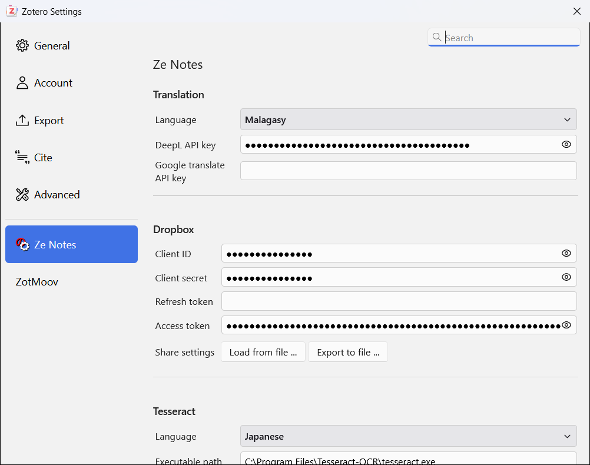

The sections below follow the order of the settings window.

## Translation

| Field | Description |
|-------|-------------|
| Language | The target language for translations |
| DeepL API key | Required to use DeepL |
| Google translate API key | Optional Cloud Translation API key |

Google translation works without a key. If you provide a Cloud Translation API key, Ze Notes uses it; otherwise it falls back to the free endpoint. DeepL only works with a key.

Once a target language is set, "Translate with Google" and "Translate with DeepL" actions appear in the context menu of the table and in the PDF reader.

## Dropbox

If you create a Dropbox app and enter its credentials here, Dropbox upload and download actions appear in the heading context menu. You only need to provide the client ID and client secret (and optionally the refresh token); Ze Notes guides you through the rest of the connection process.

| Field | Description |
|-------|-------------|
| Client ID | From your Dropbox app |
| Client secret | From your Dropbox app |
| Refresh token | Filled in during the connection process |
| Access token | Filled in during the connection process |

The two buttons in the "Share settings" row let you share these settings with co-researchers:

* **Export to file.** Saves your Dropbox settings to an encrypted file. A password is generated at export time; send the file and the password to your co-researchers separately.
* **Load from file.** Loads a file exported from another Ze Notes installation. You will need the password that was generated when it was exported.

Once connected, two actions show in the heading context menu of the table:

* **Upload to dropbox.** Exports the current collection, including notes, attachments, and annotations, zips it, and uploads it to a Dropbox folder named after the email address you enter in the dialog. The dialog shows the number of attachments, the total size, and an estimated processing time that you can tune with an export speed slider.
* **Download from dropbox.** Lists the files shared to the folder named after your own Zotero account username, with the date each file was last modified. Downloading a file imports the collection into Zotero, adding new items only, and refreshes the annotations from the imported PDF attachments.

## Tesseract

Tesseract is a program for Optical Character Recognition (OCR). If it is installed on your machine, Ze Notes can turn images in your annotations and notes into text, and an OCR action appears in the context menu for annotation images and note images.

To download Tesseract, see [https://tesseract-ocr.github.io/tessdoc/Downloads.html](https://tesseract-ocr.github.io/tessdoc/Downloads.html)

| Field | Description |
|-------|-------------|
| Language | The recognition language, chosen from the available language list |
| Executable path | Only needed if Tesseract is installed in a custom location (e.g. `C:\Program Files\Tesseract-OCR\tesseract.exe`). Ze Notes looks for the executable in the usual locations on Windows, Linux, and macOS |
| Correction AI Model | Optional. Pipes the OCR output through one of your configured AI providers to fix recognition errors while keeping the original language and structure of the text |

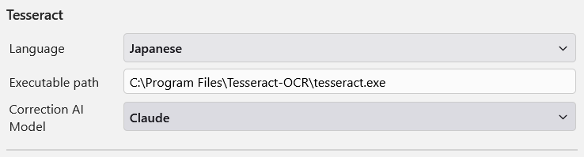

## Generative AI

Ze Notes can run AI prompts from OpenAI, Gemini, DeepSeek, and Claude if you provide the service information below. Each provider's actions appear in the context menus of the table once its API key is set, and you can run a prompt on a cell, a row, a column, the whole table, or a selected part of a cell. On notes and annotations, the prompt can also target the note, the annotation comment, the annotation quote, or the selected part of one of them.

Every provider takes a system message and a user prompt. The system message describes the role of the assistant, and the user prompt describes what to do with the data sent from the table. Adjust both until you are satisfied with the results.

An "Ai data settings" action, shown next to the AI actions in the context menu, opens a dialog where you choose which parts of your data are sent with the prompt: quotes, sources, author, and the individual tags and annotation parts, with a "Check all" toggle. The selection is saved per collection.

API keys are stored encrypted on your machine. Usage is billed by the provider, so keep an eye on your provider dashboard.

The Model list is loaded from the provider using your API key, and reloads as soon as you enter a key. If the key is missing, wrong, or expired, the list cannot be loaded and only shows an error entry, such as "gpt-api-key-error" or, for Gemini, "Error (Hover to see)". Check the key in your provider's dashboard. DeepSeek is the exception: its list is fixed (deepseek-chat and deepseek-reasoner). The Model box stays empty until you choose a model, and OpenAI has no default model, so choose one before running a prompt.

### OpenAI

Fields: API key, model, max token, system message, user prompt.

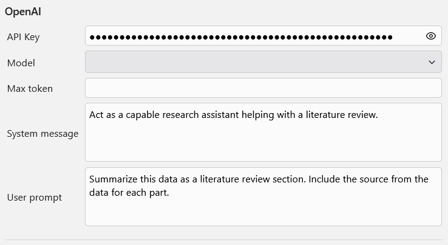
*Here the API key has expired, so the Model list could not be loaded. A wrong key looks the same.*

### Gemini

Fields: API key, model, system message, user prompt.

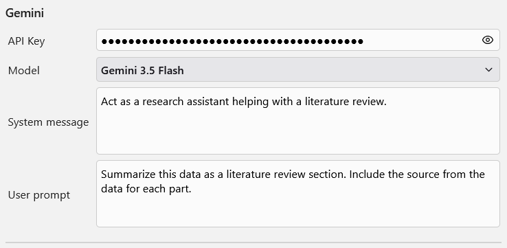

### DeepSeek

Fields: API key, model, system message, user prompt.

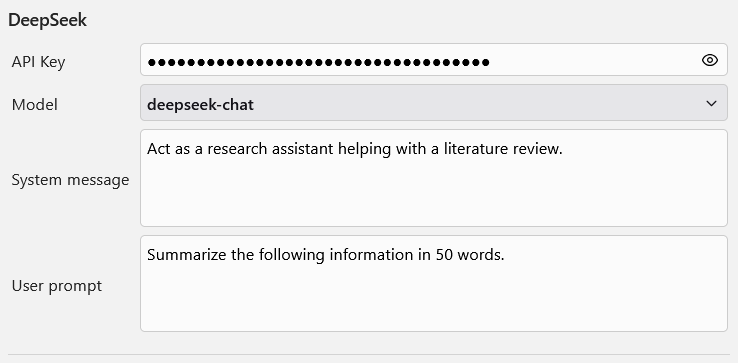

### Claude

Fields: API key, model, max token, system message, user prompt. The setup is the same as for OpenAI.

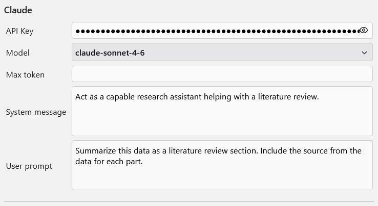

## Custom AI

You can also run prompts against providers other than the ones above, or keep several ready-to-use prompts for the same provider. The Custom AI settings let you describe the request yourself.

*Custom AI settings*
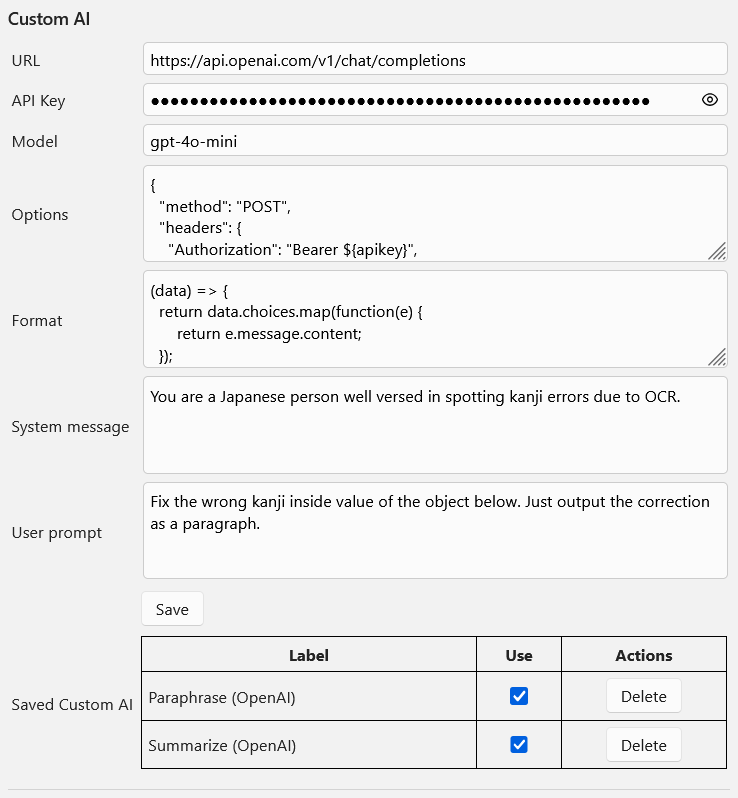

Fill in the URL, the API key, and the model. These values are used as variables in the request. Then construct the options to be sent with the request, and add a function that formats the data returned by the API. The function should return a list; for now, only the first element of that list is added to the main table upon execution.

"System message" and "User prompt" have generic default values, but you can fill them in too.

Here is a working sample value for options.

*Options sample*
```
{
  "method": "POST",
  "headers": {
    "Authorization": "Bearer ${apikey}",
    "Content-Type": "application/json"
  },
  "body": {
    "model": "${model}",
    "messages": [
      { "role": "system", "content": "${systemmessage}" },
      { "role": "user", "content": "${userprompt}" },
      { "role": "user", "content": "${data}" }
    ]
  }
}
```

Note the `${variable}` placeholders. They are replaced with your settings values when the request is sent: `${apikey}`, `${model}`, `${systemmessage}`, and `${userprompt}` come from the fields above, and `${data}` is the content sent from the table. Adapt the structure to your API.

*Format function*
```
(data) => {
  return data.choices.map(function(e) {
      return e.message.content;
  });
};
```

After setting those values, a "Using Custom AI" action shows in the context menu of the main table. Try it and adjust the system message and the user prompt until you are satisfied with the results. Once you are satisfied, click save to record the current settings under a name. Include the provider or the model in the name, for example "Summarize (OpenAI)", so you can tell which service each prompt uses; some models are expensive. Also prefer short names, since long ones can disrupt the menu.

*How to record a Custom AI API call*
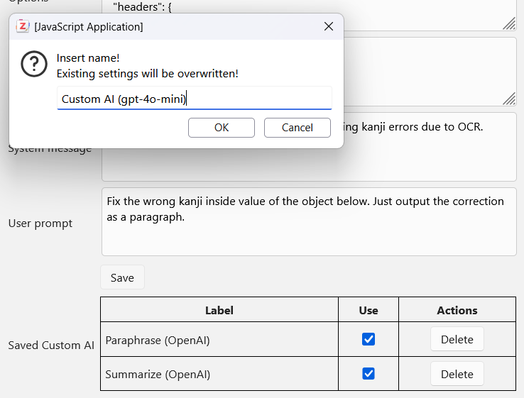

Once you click "OK", the current Custom AI settings are recorded and show in "Saved Custom AI". Check "Use" for the ones you want in the context menu of the main table, and uncheck the ones you do not use to avoid an overcrowded menu; up to 20 are shown at a time.

The image below shows how the settings are reflected in the context menu of the main table.

*Context menu reflecting Custom AI*
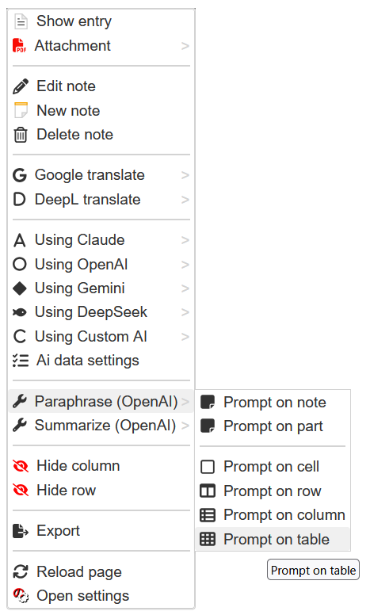

## Browser bridge (experimental)

The browser bridge lets a web page you trust, such as [Clew](https://clew.alefa.net/#/p/literature), read your Ze Notes tables and, if you allow it, write back to them. Ze Notes runs a small server inside Zotero that listens on your own computer only (`127.0.0.1`), never on the network. The bridge is off by default; with "Enable bridge" unchecked, Ze Notes behaves as if it were not there.

| Field | Description |
|-------|-------------|
| Enable bridge | Starts or stops the server. Unchecking it stops all access at once |
| Port | The local port, 23120 by default. Zotero's own connector uses 23119 |
| Pages allowed in | The web pages that may connect, one per row, matched exactly (e.g. `https://clew.alefa.net`). Any page not listed is refused. Each row has its own permissions, described below |
| Require pairing token | Asks every request for the token below. It also lets local scripts, which do not identify as a web page, connect |
| Token | The pairing token to paste into the page you connect. "Regenerate" disconnects anything already paired |
| Status | Whether the server is running, and on which port |

Each allowed page has five permissions. A change takes effect on the page's next request.

| Permission | What the page may do |
|------------|----------------------|
| READ | View collections, tables, notes, annotations and their images, and follow changes live |
| ARRANGE | Change how the table is laid out: hidden and ordered columns, colours, widths and sorting. It cannot change your notes |
| WRITE | Edit notes and annotation comments, and create or delete notes |
| AI | Run AI, translation and OCR commands through your Zotero, using your API keys and quota. Never turned on automatically |
| FILES | Download attachment files (PDF only) |

Give each page only the permissions it needs. Treat the token like a password: if you shared it by mistake, click "Regenerate".

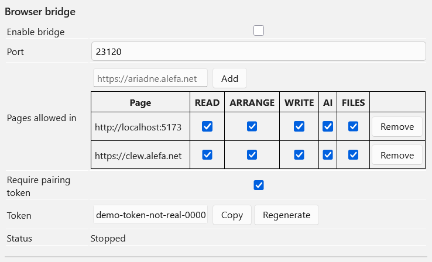

## Table display

| Field | Description |
|-------|-------------|
| Legacy display | Shows a table similar to version 0, without the fieldset |
| Hide note/annotation icons | Removes the note and annotation icons from the table |
| Main comment label | The label used for the main comment |
| Untagged column label | The label of the column holding notes and annotations without tags (default "Untagged") |
| Highlight opacity | The background opacity of highlighted quotes |
| Notes background color | The background color of notes |
| Show column sorter | Keeps the column sorter visible even when no column is hidden. Useful when you have many tags |
| Column prefix | Text added before each column heading |
| Column suffix | Text added after each column heading |
| Allow duplicate rows | Allows the same row to appear more than once |

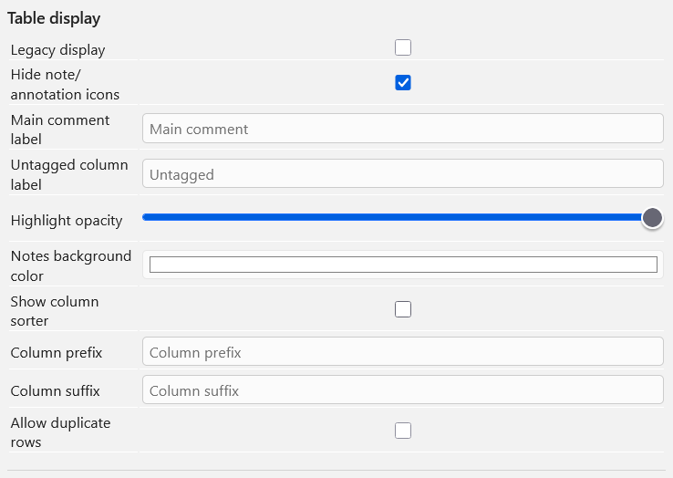

## Context menu display

Here you can set the font size of the context menu.

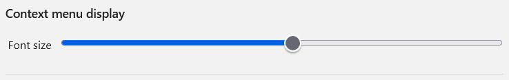

## Export

Choose "Export" from the heading or cell context menu. A dialog opens with two tabs:

* **Select data.** Choose which elements to include: quotes, sources, author, and the individual tags and annotation parts, with a "Check all" toggle.
* **Advanced settings.** Remove td styles, highlights, icons, main and sub legends, remove empty elements, and optionally create a save folder for linked resources next to the exported file.

Click "Export" and pick a file name. The extension sets the format: `.html`/`.xhtml`, `.md`, `.xlsx`, `.xls`, or `.docx`. The file opens when the export finishes, and your choices are remembered per collection.

## Context menus

Most actions in the table run from two context menus.

**Cell context menu** (right click on a cell):

* Show entry, show the annotation, or open the attachment (PDF, HTML, or image)
* Edit the note or the annotation comment, create a new note, delete a note
* Translate with Google or DeepL
* Run AI prompts and open the "Ai data settings" dialog
* OCR annotation images and note images
* Export, hide the column or the row, reload the page, open the settings

**Heading context menu** (right click on a column heading):

* **Filter data.** Show all, show tagged only, or show untagged only.
* **Show columns / Show rows / Hide column.** Bring back hidden columns and rows, or hide the current column.
* **Table sort ... / Column sort ...** Open the sorting dialogs described below.
* **Reset default widths.** Restore the original column widths.
* Export, Dropbox upload and download, find in page, reload the page, open the settings.

## Actions

* **Column resize.** Place your cursor on the right border of a column to resize it.
* **Column batch resize.** Place your cursor on the right border of a column heading to resize all the columns.
* **Rearrange columns.** Drag and drop column headers to rearrange the columns. You can do the same with "right click on heading → Column sort ...": a dialog shows where you can drag the elements around or use the arrows to move them. Click the eye icon to hide or show a column. "Show all" and "Hide all" buttons apply to every column at once.
* **Sort table.** "Right click on heading → Table sort ...". The topmost element is the first sort key and the bottommost is the last. Drag the elements to change the order. Click the sort icon to reverse the sorting; a red icon means reverse sorting is active for that element.

## Shortcuts

| Shortcut | Action |
|----------|--------|
| Ctrl+F | Open the find bar |
| Enter / F3 | Next match |
| Shift+Enter / Shift+F3 | Previous match |
| Escape | Close the find bar |
| Ctrl+Plus | Zoom in |
| Ctrl+Minus | Zoom out |
